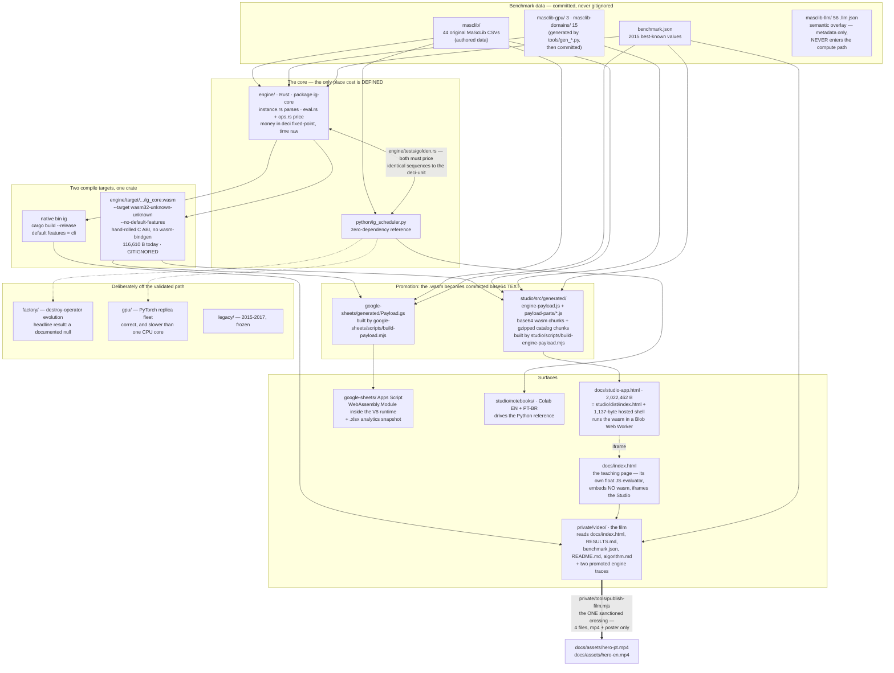
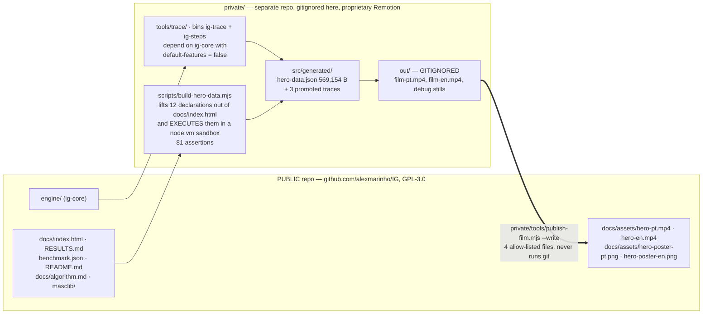

# Architecture

How a benchmark instance becomes a number on a screen, and which of the things
in this tree you are allowed to regenerate.

This document exists because [`assets/architecture.svg`](assets/architecture.svg)
— embedded in [`../README.md`](../README.md#repository-map) — asserts an
invariant without explaining it, and because the build topology it implies is
not obvious from the file tree. Read this before changing anything under
`engine/`, `studio/src/generated/`, `google-sheets/generated/` or `docs/`.

Siblings, in reading order:

- [`../AGENTS.md`](../AGENTS.md) — start there. Rules of engagement, what you may
  and may not touch. This file is the *map*; that one is the *permission*.
- [`algorithm.md`](algorithm.md) — what the solver actually does.
- [`../RESULTS.md`](../RESULTS.md) — what it found, and how that is verified.
- [`DATA-PROVENANCE.md`](DATA-PROVENANCE.md) — the "no number is typed by hand"
  rule, per number.
- [`VIDEO.md`](VIDEO.md) — the film in full. This file covers only its
  *architectural* boundary; go there for the film itself.
- [`decisions/`](decisions/) — the ADRs. Where this file says "deliberately",
  an ADR usually says why.
- [`gpu-serving.md`](gpu-serving.md) — the survey behind the GPU/LLM lenses.

Every claim below was re-measured on 2026-07-26 against branch
`race-rust-unified`. Where a committed document disagrees with the code, this
file says so and names the file and line. See
[Status and known gaps](#status-and-known-gaps).

---

## The invariant

> One objective function is defined in exactly one place. Everything else either
> compiles from it or is tested against it.

That is what the diagram means by *"one validated objective, compiled once,
reused everywhere."* The objective is:

```
total = Σ over scheduled jobs [ setupCost(prev → family) + modeCost + w · max(0, Cⱼ − dⱼ) ]
      + Σ over rejected jobs  [ rejectionCost ]
```

scheduled ASAP, with a candidate infeasible the moment any job finishes past its
hard deadline (`END_MAX`). It is defined in `engine/src/eval.rs` and
`engine/src/ops.rs`, parsed by `engine/src/instance.rs`, and prose-explained in
[`algorithm.md`](algorithm.md).

**The units trap, before anything else.** `engine/src/instance.rs:81-84`
distinguishes two parsers:

| helper | fields | scale |
|---|---|---|
| `getd` | `SETUP_COST`, `MODE_COST`, `UNPERFORMED_COST`, `TARDINESS_VARIABLE_COST`, `EARLINESS_VARIABLE_COST` | **deci — multiplied by 10** |
| `geti` | `SETUP_TIME`, `PROCESSING_TIME`, `START_MIN`, `DUE_TIME`, `END_MAX`, `ACTIVITY_ID`, `SETUP_STATE`, `FROM_STATE`, `TO_STATE`, `INITIAL_SETUP_STATE` | raw |

**All money is deci; all time is raw.** So `State::total()` and
`Outcome::best_cost` are deci, while `Params::target` is in *data* units —
`solve()` multiplies it by 10 internally. Passing a deci value as `--target`
silently searches for a goal ten times too high. The reason deci exists is in
[`../RESULTS.md`](../RESULTS.md) line 11: the data carries 0.1-granular
tardiness weights, and the 2017 Python read `0.8` as a float and diverged on the
500-job set. Full rationale:
[`decisions/0001-deci-unit-fixed-point-arithmetic.md`](decisions/0001-deci-unit-fixed-point-arithmetic.md).

The other half of the core's design — why a candidate evaluation is `O(k)` rather
than `O(n)` — is
[`decisions/0002-incremental-evaluation-absorbing-gap.md`](decisions/0002-incremental-evaluation-absorbing-gap.md).

---

## Repository layout

One line per top-level entry. Counts are `ls`-measured, not quoted.

| Entry | What it is |
|---|---|
| `engine/` | The canonical Rust core: MaScLib parser, incremental evaluator, IG solver, the six-method race, and the WebAssembly exports. Package `ig-core`, **lib target `ig_core`**, bin `ig`. |
| `python/` | `ig_scheduler.py` — a single-file, zero-dependency reference engine plus CLI; the semantic oracle the Rust core is tested against. |
| `masclib/` | The 44 original MaScLib benchmark CSVs (30 `NCOS_*` with no setups, 14 `STC_NCOS_*` with sequence-dependent family setups). Authored data — never regenerate. |
| `masclib-gpu/` | 3 synthetic GPU-serving CSVs generated by `tools/gen_gpu_instances.py`. |
| `masclib-domains/` | 15 synthetic scenario CSVs (kitchen, surgery, 3D-print farm, coffee roastery, brewery — 3 sizes each) from `tools/gen_*.py`. |
| `masclib-llm/` | 56 `.llm.json` semantic overlays re-reading existing instances as model-serving problems **without changing a single number** — metadata only, never priced. Covers all 44 `masclib/`, the 3 GPU and 9 of the 15 domain instances; kitchen and surgery have none. |
| `benchmark.json` | The 2015 best-known objective values, keyed by instance. The scorecard's reference column and the payload builders' metadata source. |
| `docs/` | The published site (`index.html`, `studio-app.html`), this file, `algorithm.md`, `gpu-serving.md`, `monografia-2015.pdf`, `assets/`, `research/`. |
| `studio/` | The browser analytics workspace: a zero-npm-dependency app, its generated engine payload, the scientific notebooks, and 68 tests. |
| `google-sheets/` | The spreadsheet laboratory: Apps Script sources, the generated `Payload.gs`, the downloadable `.xlsx`, and contract tests. |
| `factory/` | The destroy-operator evolution harness (LLM and offline backends). Off the validated path; its headline result is a documented null. |
| `gpu/` | `fleet_torch.py` — an experimental PyTorch fleet of thousands of lockstep IG replicas. Off the validated path. |
| `tools/` | Deterministic instance and manifest generators, plus `CALIBRATION.md`. Producers of `masclib-gpu/`, `masclib-domains/`, `masclib-llm/`. |
| `legacy/` | The preserved 2015 Excel/VBA and 2017 Python/PyQt project. Frozen; nothing imports it. |
| `.github/` | Three workflows: `ci.yml` (the gate), `deploy-studio.yml` (**writes commits to the repo**), `import-assets.yml` (a spent one-shot). See [CI](#ci-and-the-one-workflow-that-writes-to-the-repo). |
| `private/` | **Gitignored here** (`.gitignore:21`) and a *separate* git repository — the film's Remotion source, its data pipeline, and the agent briefs. See [The film](#the-film-and-the-publicprivate-boundary). |
| `video/` | **Debris, not a directory you should use.** Its only content is a degraded `src/generated/hero-data.json` left behind by the `private/` migration. See [Status and known gaps](#status-and-known-gaps). |
| `README.md` · `RESULTS.md` | The front door and the canonical scorecard. Both are *machine-read* by the film pipeline — see [Prose that is load-bearing](#prose-that-is-load-bearing). |
| `pyproject.toml` | Packages `python/ig_scheduler.py` as `ig-scheduler`, exposing the `ig-solve` console script. |
| `CITATION.cff` · `LICENSE.txt` | Citation metadata; GPL-3.0. |

---

## The dataflow



### Stage 1 — data in

Every CSV is `ILOG_DATA_SCHEMA,MASC,1.0`: sectioned rows where each
`SECTION|NAMES,...` header declares the columns of the `SECTION,...` rows that
follow. `engine/src/instance.rs` is the only parser in the Rust path and it
*rejects* files it cannot honour exactly — `golden.rs` has dedicated tests
`rejects_multi_mode_files` and `rejects_multi_resource_files`.

`masclib/` is data of record and must not be regenerated. `masclib-gpu/` and
`masclib-domains/` are synthetic but committed, because reproducibility of the
published numbers matters more than the few kilobytes: the generators are
deterministic from committed seeds, but a regeneration that shifted one value
would silently invalidate every recorded result for those instances.

`masclib-llm/` is the odd one out and worth understanding so you don't look for
a compute path that isn't there. Each manifest declares
`"source": "masclib/NCOS_01.csv"` and states in its own `reading.note` that the
numbers are identical to the source instance — only the semantics are new, so
published best-knowns remain valid. Nothing in `engine/`, `studio/` or
`google-sheets/` reads these files.

### Stage 2 — the core, and the cross-check

`engine/` is not in a Cargo workspace, and the repository root has **no
`Cargo.toml`** — deliberately, so nothing can absorb the engine into a
workspace and relocate its `target/`.

`python/ig_scheduler.py` is not a port kept around for nostalgia; it is the
oracle. `engine/tests/golden.rs` pins four exact deci-unit costs that the Python
implementation produced, across every instance flavour:

```rust
("masclib/NCOS_01.csv",         vec![0, 1, 2, 3, 4, 5, 6, 7],          29600),
("masclib/NCOS_31.csv",         vec![0, 1, 2, 3, 4, 5, 6, 7, 8, 9],   444400),
("masclib/STC_NCOS_31.csv",     vec![5, 1, 9, 3, 7, 0, 12, 20],       670150),
("masclib-gpu/GPU_RUSH_60.csv", vec![3, 1, 4, 5],                      69925),
```

Any semantic drift in *either* engine breaks the test. This is the edge the SVG
draws as a green `=` between the two core boxes.

The layer beneath it is `engine/src/eval.rs:367`: 500 random
insert/replace/remove operations from `Rng::new(42)`, where the incremental
prediction must equal a from-scratch brute-force evaluation at **every** step.

### Stage 3 — two compile targets from one crate

`engine/Cargo.toml` declares `crate-type = ["cdylib", "rlib"]`, a `[[bin]] ig`
gated on `required-features = ["cli"]`, and `cli = ["dep:rayon",
"dep:serde_json"]` as the default feature.

```bash
# native CLI — default features
cargo build --release --manifest-path engine/Cargo.toml

# WebAssembly — drops the bin and the two native-only deps
rustup target add wasm32-unknown-unknown
RUSTFLAGS="-C panic=abort" cargo build --release \
  --target wasm32-unknown-unknown --no-default-features \
  --manifest-path engine/Cargo.toml
```

`engine/src/lib.rs:7` gates `pub mod wasm` on `#[cfg(target_arch = "wasm32")]`
and line 13 gates `pub use solver::solve` on `not(wasm32)` — so the two targets
export genuinely different surfaces from the same sources. The WASM side is a
hand-rolled C ABI (19 `#[no_mangle] pub extern "C"` functions across
`wasm_alloc`, `inst_*`, `run_*` and `race_*`), with **no `wasm-bindgen`**:
nothing in the browser path needs a JS toolchain to bind.

> **`ig_core`, not `ig`.** The package is `ig-core`, the *library* target is
> `ig_core`, and the *binary* is `ig`. `use ig::…` does not compile. Downstream
> code writes `use ig_core::{Accept, Instance, Rng, Run, State}`.

### Stage 4 — promotion: the wasm becomes committed text

This is the step that surprises people, and the reason `engine/target/` being
gitignored does not break a fresh clone.

The `.wasm` binary is never committed and never fetched over the network.
Instead each payload builder base64-encodes it, gzips the instance catalog, and
splits both into ~6,000-character chunks written as ES modules or `.gs` files —
because, per `build-engine-payload.mjs:50`, high-entropy base64 has to survive
transcription through text-only channels. Those chunk files **are committed**.

Verified today: the base64 embedded in `studio/src/generated/engine-payload.js`
decodes to exactly the 116,610 bytes of
`engine/target/wasm32-unknown-unknown/release/ig_core.wasm`, byte-for-byte
(sha256 prefix `802eaea4de4b637c`).

```bash
# regenerate the Studio payload (needs the wasm built first)
node studio/scripts/build-engine-payload.mjs --out=studio/src/generated/engine-payload.js
# or, equivalently, from inside studio/
npm --prefix studio run payload

# regenerate the Apps Script payload
node google-sheets/scripts/build-payload.mjs
```

Same principle, different consumer: `google-sheets/generated/Payload.gs` (217,869 B)
carries the wasm plus a gzipped catalog of `masclib/` + `masclib-gpu/` only — the
domain instances are not shipped to the spreadsheet.

### Stage 5 — the surfaces

**`docs/studio-app.html`** is the real engine surface. Byte arithmetic confirms
how it is made: `studio/dist/index.html` (2,021,325 B) + a 1,137-byte hosted
shell block = 2,022,462 B. `make-hosted-embed.mjs` asserts that block's length
rather than trusting it, because the homepage iframe depends on it. At runtime
`studio/src/engine/client.js` spins a **Blob Web Worker** from
`worker-runtime.js`, which `atob`s the payload and calls
`WebAssembly.instantiate` — no fetch, no CDN, no server.

**`docs/index.html`** is the teaching page, and it is *not* an engine surface.
It embeds no wasm at all (grep for `wasmBase64|WASM_B64|AGFzbQ` returns zero
hits). It carries its own floating-point `evaluate()` at line 1627 over a
five-job demo dataset, and delegates real solving to the Studio in an iframe.
Treat its evaluator as an illustration, not as the objective — it has no
fixed-point arithmetic and no `END_MAX` feasibility check.

**`google-sheets/`** runs the same wasm inside Apps Script's V8 runtime
(`apps-script/Engine.gs:125`, `new WebAssembly.Module(wasmBytes)`), unzipping
each instance CSV lazily via `Utilities.ungzip` so listing the catalog never
decompresses anything. The downloadable
`google-sheets/dist/ig-scheduling-lab.xlsx` is an analytics-only snapshot — it
does not solve.

**`studio/notebooks/`** holds three notebooks built by `build_notebooks.py`:
`iterated-greedy-experiments.ipynb`, its `-pt-br` twin, and `future-studies.ipynb`.
They drive the *Python* reference for multi-seed statistics — the grey edge in
the SVG, not the orange WebAssembly bus. The SVG labels this box `notebooks/`;
the actual path is `studio/notebooks/`.

---

## The objective is implemented five times — and four of them are checked

[`../RESULTS.md`](../RESULTS.md) describes three verification layers. That
undercounts what is actually in the tree, so here is the full census. This
matters: if you change the objective, this is the list of things that will
break, and the one thing that will not.

| # | Implementation | Cross-checked by | Arithmetic |
|---|---|---|---|
| 1 | `engine/src/eval.rs`, `ops.rs` | `eval.rs:367 incremental_matches_bruteforce`, `ops.rs:251 new_pricers_match_bruteforce` — 500 random insert/replace/remove ops, incremental must equal from-scratch every step | deci fixed-point |
| 2 | `python/ig_scheduler.py` | `engine/tests/golden.rs::matches_python_reference_costs` (exact) | deci fixed-point |
| 3 | `studio/src/race/evaluate.js` + `studio/src/data/instance.js::evaluateSchedule` | `studio/tests/race/evaluate.test.mjs` against the WASM engine over 6 instances, `CLOSURE_TOLERANCE = 0.051`; **and live in-browser** at `studio/src/app.js:730 assertClosure`, which raises a visible *"Objective identity mismatch"* error | float, tolerance-bounded |
| 4 | `google-sheets/apps-script/Model.gs:148 IG_evaluateOrder_` | `google-sheets/tests/engine.test.mjs` — loads the Apps Script sources into a sandbox with injected globals, instantiates the *real* payload wasm, and compares the two (lines 138, 162, 170); `Engine.gs:240` additionally cross-checks the canonical and independent parsers on job count | deci via `IG_deci_` |
| 5 | `docs/index.html:1627 evaluate()` | **nothing** | float |

Two things follow.

First, layer 3 is stronger than a test: the Studio re-prices *every result it
displays* with an independent JavaScript objective and errors out if the WASM
engine disagrees by more than 0.051. `studio/src/race/evaluate.js`'s own header
explains why the file was kept after the six methods moved into Rust — *"it is
the only remaining check that the number the page prints means what the page
says it means."*

Second, implementation 5 is unguarded, and it is the one the film executes (see
below). Its `total` also *includes* processing cost, where the film's on-screen
bill deliberately excludes it. Both are defensible; they are not the same
number. Do not treat `docs/index.html`'s evaluator as authoritative.

`../RESULTS.md:20` places the property test in `engine/src/solver.rs::tests`. It
is in `engine/src/eval.rs:367`. The test exists and passes; only the citation is
stale.

---

## Build and release topology

### Generated versus authored

| Path | Producer | State |
|---|---|---|
| `studio/src/generated/engine-payload.js`, `payload-parts/*.js` | `studio/scripts/build-engine-payload.mjs` | generated, **committed** |
| `studio/src/generated/instance-stats.js` | `studio/scripts/build-instance-stats.mjs` | generated, **committed** |
| `studio/src/generated/scene-assets/` | `studio/scripts/build-scene-assets.mjs` | generated, **committed** |
| `google-sheets/generated/Payload.gs` | `google-sheets/scripts/build-payload.mjs` | generated, **committed** |
| `google-sheets/generated/sample-data.json` | `google-sheets/scripts/generate-sample.mjs` | generated, **committed** |
| `google-sheets/dist/ig-scheduling-lab.xlsx` | `google-sheets/scripts/build-workbook.mjs` | generated, **committed** (the sole `dist/` exception) |
| `docs/studio-app.html` | `studio/scripts/build.mjs` → `make-hosted-embed.mjs` | generated, **committed**, and auto-committed by CI |
| `masclib-gpu/*.csv`, `masclib-domains/*.csv` | `tools/gen_*.py` | generated once, **committed**, treat as data |
| `masclib-llm/*.json` | `tools/generate*_llm_layers.py` | generated once, **committed** |
| `engine/target/**` | `cargo` | generated, **gitignored** (`engine/.gitignore:1`) |
| `studio/dist/**` | `studio/scripts/build.mjs` | generated, **gitignored** (`.gitignore:6` `dist/`) |
| `google-sheets/dist/apps-script/**` | `prepare-apps-script.mjs` | generated, **gitignored** (`.gitignore:13`) |
| `private/video/out/**` | Remotion | generated, **gitignored** (`private/video/.gitignore`) |
| `docs/index.html` | **nobody — hand-authored** | authored; see gaps |
| `engine/src/**`, `python/**`, `studio/src/**` (non-generated), `google-sheets/apps-script/**` | humans | authored |

The rule of thumb: **anything a browser must load without a network request is
generated, then committed.** Anything a developer's toolchain can rebuild in
seconds is gitignored. The `.wasm` is the only artefact that appears on both
sides of that line — gitignored as a binary, committed as base64 text.

### Committed versus gitignored, and why `private/` is neither

`.gitignore` at the root ignores `private/`, `.claude/`, `.codex/` and
`.gemini/`. `private/` is not a submodule: it is an independent git repository
(`origin = github.com/alexmarinho/IG-private`, branch `main`) living inside the
parent's ignored tree. `git status` here will never follow it and
`git worktree list` does not know about it.

A `private/tools/hooks/pre-commit` exists and refuses staged paths matching
`private/*`, `video/*`, `.claude/*`, `.codex/*`, `.gemini/*`, `.cursor/*`,
`*.env`, `*.pem`, `*.key`, `*id_rsa*`, `*node_modules/*`, `*/target/*`, and any
file over 25 MB. It is **not versioned** — a fresh clone has no such protection.
Its own header records the install line and the reasoning: a commit here is one
push away from permanent and public, so it refuses rather than trusting the
ignore file.

```bash
ln -sf ../../private/tools/hooks/pre-commit .git/hooks/pre-commit
```

### CI, and the one workflow that writes to the repo

`.github/workflows/ci.yml` triggers on `push: branches: [master]` and on all
pull requests. **Pushing to `race-rust-unified` — the current branch — runs
nothing.** In order, CI runs: `cargo test --release`; the wasm32 build; the
Python golden tests; the factory smoke tests; a *fresh* payload regeneration
followed by `npm --prefix studio test|check|build`; the Google Sheets contract
tests and an `.xlsx --check`; a pip-install smoke test asserting `best=800` on
`NCOS_01`; and a benchmark spot-check asserting `best=17611` on `STC_NCOS_15` in
20 s.

The payload regeneration step is the important one: CI does not trust the
committed payload, it rebuilds it from the current CSVs and the wasm it just
compiled, and then runs the tests against that. A stale committed payload
therefore fails in CI at the `studio run check` step, not silently.

`.github/workflows/deploy-studio.yml` triggers on pushes to `master` touching
`studio/**`, `engine/**`, `masclib*/**` or itself, and it **commits and pushes**
`docs/studio-app.html` and `studio/src/generated/` as
`"studio: rebuild published app [skip ci]"`. If files appear modified in your
worktree that you did not touch, this bot is the most likely explanation. Check
`git diff --cached --name-only` before every commit.

`.github/workflows/import-assets.yml` is a spent one-shot bound to the branch
`feat/scenario-levels`; it fetched three scenario images from expiring signed
URLs. It cannot run on `master` or on the current branch. Treat it as history.

### Reproducing the release checks

```bash
cargo test --release --manifest-path engine/Cargo.toml   # 38 pass / 2 ignored, +4 golden, +6 race
python3 python/test_ig_scheduler.py                      # 4 tests
python3 factory/test_factory.py
npm --prefix studio test                                  # 68 tests
npm --prefix studio run check
npm --prefix studio run build                             # writes studio/dist/ (gitignored)
node --test google-sheets/tests/*.test.mjs                # 16 tests — the glob is required
python3 google-sheets/scripts/normalize-workbook.py --check google-sheets/dist/ig-scheduling-lab.xlsx
```

> `node --test google-sheets/tests/` (directory form, no glob) fails with
> `MODULE_NOT_FOUND` on node v23.7.0. Use the glob, as CI does.

Measured today: 38 passed / 2 ignored in `ig_core`, 4 golden, 6 race, 4 Python,
3 factory, 68 Studio, 16 Google Sheets.

The two `--ignored` Rust tests are `race::tabu::tests::print_golden` and
`probe_search_progress` — developer probes, not coverage gaps. Run them with
`cargo test --release -- --ignored`.

Measured on an Apple M3 Max (14 cores), `rustc 1.97.1`, `node v23.7.0`,
Python 3.14.3:

```
$ cargo run --release --quiet -- solve ../masclib/NCOS_31.csv --seconds 5 --seed 1
NCOS_31: n=75 best=9420 iters=398461 evals=138909638 (27.78 Mevals/s) t=5.00s
  performed 74 / rejected 1

$ python3 python/ig_scheduler.py solve masclib/NCOS_01.csv --seconds 3
NCOS_01: n=8 best=800 iters=134867 evals=3641976 (1214k evals/s) t=3.00s
```

The full benchmark protocol — 44 instances × 45 s × 3 seeds — is roughly 99
minutes single-core. CI spot-checks one instance instead. **Never quote a
quality number without its protocol**: `NCOS_31` legitimately reads 9,420
(10 s × 6 seeds, dedicated run), 9,460 (in-browser WASM) and 9,490 (the uniform
45 s × 3 validation run) in different places, and
[`../RESULTS.md`](../RESULTS.md) reports all three.

---

## The film, and the public/private boundary

The newest surface is a 111-second Remotion film for the top of the page
(`npx remotion compositions src/index.ts` reports
`Hero  30  1920x1080  3334 (111.13 sec)`). Its source is **not in this
repository** and, as of this writing, is not committed anywhere: `private/` has
zero commits on `main`.

**[`VIDEO.md`](VIDEO.md) documents the film.** This section documents only the
three things about it that are *architecture* — where the boundary runs, why
artefacts are promoted across it, and what may cross into the public tree.



**1. The film obeys the same invariant this document opens with.**
`build-hero-data.mjs` does not reimplement the page's arithmetic — it extracts
twelve declarations (`evaluate`, `permutations`, `DEMO1`, `factorial`, …) as
*text* and runs them in a `node:vm` sandbox. One definition; everything else
tested against it — the same discipline as `golden.rs`. Detail:
[`DATA-PROVENANCE.md`](DATA-PROVENANCE.md) and
[`decisions/0003-film-data-provenance-hero-data-json.md`](decisions/0003-film-data-provenance-hero-data-json.md).

**2. Promotion into `src/generated/` exists for exactly the reason given in
[Stage 4](#stage-4-promotion-the-wasm-becomes-committed-text).**
`private/video/.gitignore` contains `out/`, which matches `tools/trace/out/` at
any depth — so the trace tool's own output is invisible to git and would be
invisible to CI. The traces are therefore *promoted*:
`tools/trace/out/ncos31-seed1.json` is copied to
`src/generated/trace-ncos31.json` (both 65,814 B) and committed. Without that
copy a fresh checkout would have no convergence curve. Two of the three traces
must then never be regenerated, because they were produced with a wall-clock
budget and the row count is a property of the machine. Rationale:
[`decisions/0004-promoted-engine-traces.md`](decisions/0004-promoted-engine-traces.md).

This is the same trade the `.wasm` makes: a gitignored artefact that CI could not
see is copied, once, into a committed location. If you find yourself adding a
third instance of this pattern, it is a pattern, not a hack — document it here.

**3. The licence tension is why the split exists at all.** This repository is
GPL-3.0; Remotion is not open source. `private/` keeps the proprietary-dependent
build out of the GPL tree, and `private/tools/publish-film.mjs` is the single
sanctioned crossing — a four-entry allow-list of rendered outputs. Its header is
explicit that the Remotion project, the pipeline, `hero-data.json`, the traces,
`node_modules` and the briefs never cross, and that the script never runs `git`,
because committing is a human decision. Full argument:
[`decisions/0010-remotion-in-repo-despite-licence.md`](decisions/0010-remotion-in-repo-despite-licence.md).

---

## Prose that is load-bearing

Some English sentences in this repository are parsed by code and will throw if
reworded. This is the least discoverable hazard in the tree.

`build-hero-data.mjs::readThroughput()` reads the Rust throughput figure out of
three files and throws if any is missing *or if they disagree*:

| File | Required pattern |
|---|---|
| `RESULTS.md` (line 10) | `~(\d+)M evals/s/core` |
| `README.md` (line 223) | `~(\d+)M evaluations/s/core` |
| `docs/algorithm.md` (line 74) | `~(\d+)M candidates/second/core` |

It also parses the `NCOS_31` row of `RESULTS.md`'s improvements table with this
regex, and the `STC_NCOS_01` row of the per-instance code block:

```js
/^\|\s*`NCOS_31`\s*\|\s*([\d,]+)\s*\|\s*\*\*([\d,]+)\*\*\s*\|/m
```

**Reformatting those tables breaks the film build** — the cell order, the
backticks around the instance name and the `**bold**` on the found value are all
load-bearing. If you edit `RESULTS.md` or `README.md`, re-run
`node private/video/scripts/check-hero-data.mjs` before you commit.

Similarly, `make-hosted-embed.mjs` asserts its hosted block is exactly 1,137
bytes, and `Act3Truth.tsx` in the film throws at module load unless two
independently computed setup costs still agree. These are features: the build
fails loudly rather than shipping something false.

---

## Status and known gaps

Verified failures of documentation-to-code correspondence, as of 2026-07-26 on
`race-rust-unified`. None of these are broken *code*; all of them will mislead a
reader who trusts the document over the tree.

**In the diagram this file describes** — `docs/assets/architecture.svg`:

- It labels a surface `notebooks/`. The path is `studio/notebooks/`.
- It says the Studio carries **53 fixed instances**. The current payload carries
  **62** (39 standard, 14 setup, 3 gpu, 3 kitchen, 3 surgery). 53 was correct
  when `masclib-domains/` held 6 CSVs; it now holds 15. Re-derive with:
  ```bash
  node --input-type=module -e "
  import {gunzipSync} from 'node:zlib';
  import {IG_ENGINE_PAYLOAD as p} from './studio/src/generated/engine-payload.js';
  console.log(Object.keys(JSON.parse(gunzipSync(Buffer.from(p.catalogGzipBase64,'base64')))).length);"
  ```
- It does not show the film at all, because the film postdates it.
- `docs/assets/architecture.png` (102,479 B) is a raster twin of the SVG and is
  referenced by nothing. The SVG is the one `README.md:191` embeds.

**Elsewhere:**

- **`engine/README.md:16` documents a command that cannot run.**
  `python3 ../tools/build_demo.py`, described as re-embedding the module and
  instances into `docs/index.html`, refers to a file deleted in commit
  `17821f4` ("purge 15k lines of dead prototype"). `docs/index.html` therefore
  has **no reproducible builder in the tree**. It is hand-maintained. This is
  the single largest hole in the build topology and I could not close it: I do
  not know whether the file is now intentionally hand-authored or whether its
  builder was lost.
- **`engine/README.md:14` says the WASM build is 84 KB.** The committed `HEAD`
  payload decodes to 87,933 B (86 KB), so the figure was about right; the
  current build is **116,610 B (114 KB)** — the six racers grew it by 28,677 B.
- **The committed Studio payload is behind the current engine.** `HEAD` tracks
  20 wasm chunks; the worktree has 26, six of them untracked. CI rebuilds the
  payload before testing, so this cannot ship silently — but a local
  `npm --prefix studio test` run against the committed payload is testing an
  older engine.
- **`README.md:202` and `masclib-domains/README.md:3` both say six domain
  workloads.** There are 15 CSVs; `masclib-domains/README.md` documents only
  the kitchen and surgery six and never mentions 3DPRINT, BREWERY or COFFEE.
- **`../RESULTS.md:20` cites the wrong file** for the brute-force property test
  (`solver.rs::tests`; actually `eval.rs:367`).
- **`../RESULTS.md` and `docs/algorithm.md` understate Python throughput.**
  RESULTS says `~150–330k evals/s`, algorithm.md says `~300k/s`, README says
  `~1M/s`. Measured here: **1,214k**. Only the Rust figure is machine-checked
  (see [load-bearing prose](#prose-that-is-load-bearing)); the Python figures
  are unpoliced and mutually inconsistent.
- **`tools/generate_llm_layers.py:16` and
  `tools/generate_extra_llm_layers.py:11` hardcode
  `/mnt/agents/work/repo/masclib-domains`** — an absolute path from a different
  machine. Those two generators cannot regenerate `masclib-llm/` in a clone.
  `tools/gen_extra_scenarios.py` registers eight domains (coffee, bakery,
  dental, laser, laundry, studio, lab, brewery); only coffee and brewery exist
  as CSVs.
- **`video/src/generated/hero-data.json` is debris and should be deleted, not
  documented.** 304,375 B, with `convergence`, `steps` and `deadline` all
  `null` — a hero-data artefact missing the film's entire climax, written
  mid-migration. The real one is `private/video/src/generated/hero-data.json`
  (569,154 B, 331 convergence points). The pre-commit hook would refuse to stage
  the debris; nothing deletes it.
- **CI does not test the film**, despite comments in the film's source claiming
  the data is "checked in CI". There is no `video/` or `private/` step in
  `ci.yml`, and there cannot be while the source lives in an ignored sibling
  repository.
- **The film's source is committed nowhere.** `private/` is a git repository
  with zero commits. Everything in [The film](#the-film-and-the-publicprivate-boundary)
  describes working-tree state only.

**What I did not verify.**

- I did not run the 99-minute full benchmark protocol, so the 39/44 scorecard is
  quoted from `../RESULTS.md`, not re-measured. The five per-instance numbers
  quoted in this file come from `../RESULTS.md` and from the two solve runs
  transcribed above.
- I did not run `npm --prefix studio run check` or `run build`. `studio/**` and
  `docs/index.html` carry uncommitted edits from another session and are under a
  do-not-touch order, and `build` writes into `studio/dist/`. So the byte
  arithmetic for `docs/studio-app.html` (2,021,325 + 1,137 = 2,022,462) is a
  measurement of the *existing committed files*, not of a rebuild I performed.
- I did not render the film, and I did not re-run `build-hero-data.mjs` or
  `check-hero-data.mjs`. The film's file sizes, the trace byte-identity and the
  `out/` inventory are `ls`-measured; the pipeline's internal behaviour is read
  from its sources. I did confirm `npx remotion compositions` reports
  `Hero  30  1920x1080  3334 (111.13 sec)`.
- The Apps Script objective *is* executed outside Google — `engine.test.mjs`
  sandboxes the `.gs` sources and instantiates the real payload wasm — so row 4
  of the census is test-backed. What I could **not** observe is the hosted
  behaviour: the Sheets writes, the authorization path and the 6-minute
  execution limit are described from the sources only.
- I did not audit `factory/` or `gpu/` beyond running `test_factory.py` (3 tests,
  pass). Their results are quoted from `../RESULTS.md`.
