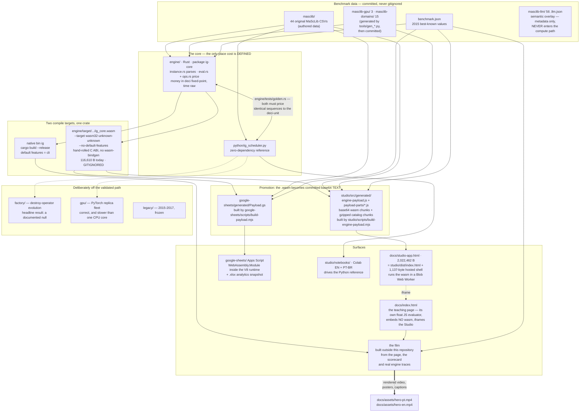

# Architecture

How a benchmark instance becomes a number on a screen, and which of the things
in this tree you are allowed to regenerate.

The diagram in [`assets/architecture.svg`](assets/architecture.svg) asserts an
invariant without explaining it, and the build topology it implies is not
obvious from the file tree. Read this before changing anything under
`engine/`, `studio/src/generated/`, `google-sheets/generated/` or `docs/`.

Siblings, in reading order:

- [`algorithm.md`](algorithm.md) — what the solver actually does.
- [`../RESULTS.md`](../RESULTS.md) — what it found, and how that is verified.
- [`gpu-serving.md`](gpu-serving.md) — the survey behind the GPU/LLM lenses.

Measurements below were taken on 2026-07-26 unless a section says otherwise.

---

## The invariant

> One objective function is defined in exactly one place. Everything else either
> compiles from it or is tested against it.

That is what the diagram means by *"one validated objective, compiled once,
reused everywhere."* The objective is:

```
total = Σ over scheduled jobs [ setupCost(prev → family) + modeCost + w · max(0, Cⱼ − dⱼ) ]
      + Σ over rejected jobs  [ rejectionCost ]
```

scheduled ASAP, with a candidate infeasible the moment any job finishes past its
hard deadline (`END_MAX`). It is defined in `engine/src/eval.rs` and
`engine/src/ops.rs`, parsed by `engine/src/instance.rs`, and prose-explained in
[`algorithm.md`](algorithm.md).

**The units trap, before anything else.** `engine/src/instance.rs:81-84`
distinguishes two parsers:

| helper | fields | scale |
|---|---|---|
| `getd` | `SETUP_COST`, `MODE_COST`, `UNPERFORMED_COST`, `TARDINESS_VARIABLE_COST`, `EARLINESS_VARIABLE_COST` | **deci — multiplied by 10** |
| `geti` | `SETUP_TIME`, `PROCESSING_TIME`, `START_MIN`, `DUE_TIME`, `END_MAX`, `ACTIVITY_ID`, `SETUP_STATE`, `FROM_STATE`, `TO_STATE`, `INITIAL_SETUP_STATE` | raw |

**All money is deci; all time is raw.** So `State::total()` and
`Outcome::best_cost` are deci, while `Params::target` is in *data* units —
`solve()` multiplies it by 10 internally. Passing a deci value as `--target`
silently searches for a goal ten times too high. The reason deci exists is in
[`../RESULTS.md`](../RESULTS.md) line 11: the data carries 0.1-granular
tardiness weights, and the 2017 Python read `0.8` as a float and diverged on the
500-job set.

The other half of the core's design — why a candidate evaluation is `O(k)` rather
than `O(n)` — is explained in [`algorithm.md`](algorithm.md).

---

## Repository layout

One line per top-level entry. Counts are `ls`-measured, not quoted.

| Entry | What it is |
|---|---|
| `engine/` | The canonical Rust core: MaScLib parser, incremental evaluator, IG solver, the six-method race, and the WebAssembly exports. Package `ig-core`, **lib target `ig_core`**, bin `ig`. |
| `python/` | `ig_scheduler.py` — a single-file, zero-dependency reference engine plus CLI; the semantic oracle the Rust core is tested against. |
| `masclib/` | The 44 original MaScLib benchmark CSVs (30 `NCOS_*` with no setups, 14 `STC_NCOS_*` with sequence-dependent family setups). Authored data — never regenerate. |
| `masclib-gpu/` | 3 synthetic GPU-serving CSVs generated by `tools/gen_gpu_instances.py`. |
| `masclib-domains/` | 15 synthetic scenario CSVs (kitchen, surgery, 3D-print farm, coffee roastery, brewery — 3 sizes each) from `tools/gen_*.py`. |
| `masclib-llm/` | 56 `.llm.json` semantic overlays re-reading existing instances as model-serving problems **without changing a single number** — metadata only, never priced. Covers all 44 `masclib/`, the 3 GPU and 9 of the 15 domain instances; kitchen and surgery have none. |
| `benchmark.json` | The 2015 best-known objective values, keyed by instance. The scorecard's reference column and the payload builders' metadata source. |
| `docs/` | The published site (`index.html`, `studio-app.html`), this file, `algorithm.md`, `gpu-serving.md`, `monografia-2015.pdf`, `assets/`. |
| `studio/` | The browser analytics workspace: a zero-npm-dependency app, its generated engine payload, the scientific notebooks, and 68 tests. |
| `google-sheets/` | The spreadsheet laboratory: Apps Script sources, the generated `Payload.gs`, the downloadable `.xlsx`, and contract tests. |
| `factory/` | The destroy-operator evolution harness (LLM and offline backends). Off the validated path; its headline result is a documented null. |
| `gpu/` | `fleet_torch.py` — an experimental PyTorch fleet of thousands of lockstep IG replicas. Off the validated path. |
| `tools/` | Deterministic instance and manifest generators. Producers of `masclib-gpu/`, `masclib-domains/`, `masclib-llm/`. |
| `legacy/` | The preserved 2015 Excel/VBA and 2017 Python/PyQt project. Frozen; nothing imports it. |
| `.github/` | Two workflows: `ci.yml` (the gate) and `deploy-studio.yml` (**writes commits to the repo**). See [CI](#ci-and-the-one-workflow-that-writes-to-the-repo). |
| `README.md` · `RESULTS.md` | The front door and the canonical scorecard. |
| `pyproject.toml` | Packages `python/ig_scheduler.py` as `ig-scheduler`, exposing the `ig-solve` console script. |
| `CITATION.cff` · `LICENSE.txt` | Citation metadata; GPL-3.0. |

---

## The dataflow



### Stage 1 — data in

Every CSV is `ILOG_DATA_SCHEMA,MASC,1.0`: sectioned rows where each
`SECTION|NAMES,...` header declares the columns of the `SECTION,...` rows that
follow. `engine/src/instance.rs` is the only parser in the Rust path and it
*rejects* files it cannot honour exactly — `golden.rs` has dedicated tests
`rejects_multi_mode_files` and `rejects_multi_resource_files`.

`masclib/` is data of record and must not be regenerated. `masclib-gpu/` and
`masclib-domains/` are synthetic but committed, because reproducibility of the
published numbers matters more than the few kilobytes: the generators are
deterministic from committed seeds, but a regeneration that shifted one value
would silently invalidate every recorded result for those instances.

`masclib-llm/` is the odd one out and worth understanding so you don't look for
a compute path that isn't there. Each manifest declares
`"source": "masclib/NCOS_01.csv"` and states in its own `reading.note` that the
numbers are identical to the source instance — only the semantics are new, so
published best-knowns remain valid. Nothing in `engine/`, `studio/` or
`google-sheets/` reads these files.

### Stage 2 — the core, and the cross-check

`engine/` is not in a Cargo workspace, and the repository root has **no
`Cargo.toml`** — deliberately, so nothing can absorb the engine into a
workspace and relocate its `target/`.

`python/ig_scheduler.py` is not a port kept around for nostalgia; it is the
oracle. `engine/tests/golden.rs` pins four exact deci-unit costs that the Python
implementation produced, across every instance flavour:

```rust
("masclib/NCOS_01.csv",         vec![0, 1, 2, 3, 4, 5, 6, 7],          29600),
("masclib/NCOS_31.csv",         vec![0, 1, 2, 3, 4, 5, 6, 7, 8, 9],   444400),
("masclib/STC_NCOS_31.csv",     vec![5, 1, 9, 3, 7, 0, 12, 20],       670150),
("masclib-gpu/GPU_RUSH_60.csv", vec![3, 1, 4, 5],                      69925),
```

Any semantic drift in *either* engine breaks the test. This is the edge the SVG
draws as a green `=` between the two core boxes.

The layer beneath it is `engine/src/eval.rs:367`: 500 random
insert/replace/remove operations from `Rng::new(42)`, where the incremental
prediction must equal a from-scratch brute-force evaluation at **every** step.

### Stage 3 — two compile targets from one crate

`engine/Cargo.toml` declares `crate-type = ["cdylib", "rlib"]`, a `[[bin]] ig`
gated on `required-features = ["cli"]`, and `cli = ["dep:rayon",
"dep:serde_json"]` as the default feature.

```bash
# native CLI — default features
cargo build --release --manifest-path engine/Cargo.toml

# WebAssembly — drops the bin and the two native-only deps
rustup target add wasm32-unknown-unknown
RUSTFLAGS="-C panic=abort" cargo build --release \
  --target wasm32-unknown-unknown --no-default-features \
  --manifest-path engine/Cargo.toml
```

`engine/src/lib.rs:7` gates `pub mod wasm` on `#[cfg(target_arch = "wasm32")]`
and line 13 gates `pub use solver::solve` on `not(wasm32)` — so the two targets
export genuinely different surfaces from the same sources. The WASM side is a
hand-rolled C ABI (19 `#[no_mangle] pub extern "C"` functions across
`wasm_alloc`, `inst_*`, `run_*` and `race_*`), with **no `wasm-bindgen`**:
nothing in the browser path needs a JS toolchain to bind.

> **`ig_core`, not `ig`.** The package is `ig-core`, the *library* target is
> `ig_core`, and the *binary* is `ig`. `use ig::…` does not compile. Downstream
> code writes `use ig_core::{Accept, Instance, Rng, Run, State}`.

### Stage 4 — promotion: the wasm becomes committed text

This is the step that surprises people, and the reason `engine/target/` being
gitignored does not break a fresh clone.

The `.wasm` binary is never committed and never fetched over the network.
Instead each payload builder base64-encodes it, gzips the instance catalog, and
splits both into ~6,000-character chunks written as ES modules or `.gs` files —
because, per `build-engine-payload.mjs:50`, high-entropy base64 has to survive
transcription through text-only channels. Those chunk files **are committed**.

Verified on 2026-07-26: the base64 embedded in `studio/src/generated/engine-payload.js`
decodes to exactly the 116,610 bytes of
`engine/target/wasm32-unknown-unknown/release/ig_core.wasm`, byte-for-byte
(sha256 prefix `802eaea4de4b637c`).

```bash
# regenerate the Studio payload (needs the wasm built first)
node studio/scripts/build-engine-payload.mjs --out=studio/src/generated/engine-payload.js
# or, equivalently, from inside studio/
npm --prefix studio run payload

# regenerate the Apps Script payload
node google-sheets/scripts/build-payload.mjs
```

Same principle, different consumer: `google-sheets/generated/Payload.gs` (217,869 B)
carries the wasm plus a gzipped catalog of `masclib/` + `masclib-gpu/` only — the
domain instances are not shipped to the spreadsheet.

### Stage 5 — the surfaces

**`docs/studio-app.html`** is the real engine surface. Byte arithmetic confirms
how it is made: `studio/dist/index.html` (2,021,325 B) + a 1,137-byte hosted
shell block = 2,022,462 B. `make-hosted-embed.mjs` asserts that block's length
rather than trusting it, because the homepage iframe depends on it. At runtime
`studio/src/engine/client.js` spins a **Blob Web Worker** from
`worker-runtime.js`, which `atob`s the payload and calls
`WebAssembly.instantiate` — no fetch, no CDN, no server.

**`docs/index.html`** is the teaching page, and it is *not* an engine surface.
It embeds no wasm at all (grep for `wasmBase64|WASM_B64|AGFzbQ` returns zero
hits). It carries its own floating-point `evaluate()` at line 1627 over a
five-job demo dataset, and delegates real solving to the Studio in an iframe.
Treat its evaluator as an illustration, not as the objective — it has no
fixed-point arithmetic and no `END_MAX` feasibility check.

**`google-sheets/`** runs the same wasm inside Apps Script's V8 runtime
(`apps-script/Engine.gs:125`, `new WebAssembly.Module(wasmBytes)`), unzipping
each instance CSV lazily via `Utilities.ungzip` so listing the catalog never
decompresses anything. The downloadable
`google-sheets/dist/ig-scheduling-lab.xlsx` is an analytics-only snapshot — it
does not solve.

**`studio/notebooks/`** holds three notebooks built by `build_notebooks.py`:
`iterated-greedy-experiments.ipynb`, its `-pt-br` twin, and `future-studies.ipynb`.
They drive the *Python* reference for multi-seed statistics — the grey edge in
the SVG, not the orange WebAssembly bus. The SVG labels this box `notebooks/`;
the actual path is `studio/notebooks/`.

---

## The objective is implemented five times — and four of them are checked

[`../RESULTS.md`](../RESULTS.md) describes three verification layers. That
undercounts what is actually in the tree, so here is the full census. This
matters: if you change the objective, this is the list of things that will
break, and the one thing that will not.

| # | Implementation | Cross-checked by | Arithmetic |
|---|---|---|---|
| 1 | `engine/src/eval.rs`, `ops.rs` | `eval.rs:367 incremental_matches_bruteforce`, `ops.rs:251 new_pricers_match_bruteforce` — 500 random insert/replace/remove ops, incremental must equal from-scratch every step | deci fixed-point |
| 2 | `python/ig_scheduler.py` | `engine/tests/golden.rs::matches_python_reference_costs` (exact) | deci fixed-point |
| 3 | `studio/src/race/evaluate.js` + `studio/src/data/instance.js::evaluateSchedule` | `studio/tests/race/evaluate.test.mjs` against the WASM engine over 6 instances, `CLOSURE_TOLERANCE = 0.051`; **and live in-browser** at `studio/src/app.js:730 assertClosure`, which raises a visible *"Objective identity mismatch"* error | float, tolerance-bounded |
| 4 | `google-sheets/apps-script/Model.gs:148 IG_evaluateOrder_` | `google-sheets/tests/engine.test.mjs` — loads the Apps Script sources into a sandbox with injected globals, instantiates the *real* payload wasm, and compares the two (lines 138, 162, 170); `Engine.gs:240` additionally cross-checks the canonical and independent parsers on job count | deci via `IG_deci_` |
| 5 | `docs/index.html:1627 evaluate()` | **nothing** | float |

Two things follow.

First, layer 3 is stronger than a test: the Studio re-prices *every result it
displays* with an independent JavaScript objective and errors out if the WASM
engine disagrees by more than 0.051. `studio/src/race/evaluate.js`'s own header
explains why the file was kept after the six methods moved into Rust — *"it is
the only remaining check that the number the page prints means what the page
says it means."*

Second, implementation 5 is unguarded, and it is the one the film executes (see
below). Its `total` also *includes* processing cost, where the film's on-screen
bill deliberately excludes it. Both are defensible; they are not the same
number. Do not treat `docs/index.html`'s evaluator as authoritative.

---

## Build and release topology

### Generated versus authored

| Path | Producer | State |
|---|---|---|
| `studio/src/generated/engine-payload.js`, `payload-parts/*.js` | `studio/scripts/build-engine-payload.mjs` | generated, **committed** |
| `studio/src/generated/instance-stats.js` | `studio/scripts/build-instance-stats.mjs` | generated, **committed** |
| `studio/src/generated/scene-assets/` | `studio/scripts/build-scene-assets.mjs` | generated, **committed** |
| `google-sheets/generated/Payload.gs` | `google-sheets/scripts/build-payload.mjs` | generated, **committed** |
| `google-sheets/generated/sample-data.json` | `google-sheets/scripts/generate-sample.mjs` | generated, **committed** |
| `google-sheets/dist/ig-scheduling-lab.xlsx` | `google-sheets/scripts/build-workbook.mjs` | generated, **committed** (the sole `dist/` exception) |
| `docs/studio-app.html` | `studio/scripts/build.mjs` → `make-hosted-embed.mjs` | generated, **committed**, and auto-committed by CI |
| `masclib-gpu/*.csv`, `masclib-domains/*.csv` | `tools/gen_*.py` | generated once, **committed**, treat as data |
| `masclib-llm/*.json` | `tools/generate*_llm_layers.py` | generated once, **committed** |
| `engine/target/**` | `cargo` | generated, **gitignored** (`engine/.gitignore:1`) |
| `studio/dist/**` | `studio/scripts/build.mjs` | generated, **gitignored** (`.gitignore:6` `dist/`) |
| `google-sheets/dist/apps-script/**` | `prepare-apps-script.mjs` | generated, **gitignored** (`.gitignore:13`) |
| `docs/index.html` | **nobody — hand-authored** | authored; see gaps |
| `engine/src/**`, `python/**`, `studio/src/**` (non-generated), `google-sheets/apps-script/**` | humans | authored |

The rule of thumb: **anything a browser must load without a network request is
generated, then committed.** Anything a developer's toolchain can rebuild in
seconds is gitignored. The `.wasm` is the only artefact that appears on both
sides of that line — gitignored as a binary, committed as base64 text.

### CI, and the one workflow that writes to the repo

`.github/workflows/ci.yml` triggers on `push: branches: [master]` and on all
pull requests. **Pushes to any other branch run nothing until a pull request is
open.** In order, CI runs: `cargo test --release`; the wasm32 build; the
Python golden tests; the factory smoke tests; a *fresh* payload regeneration
followed by `npm --prefix studio test|check|build`; the Google Sheets contract
tests and an `.xlsx --check`; a pip-install smoke test asserting `best=800` on
`NCOS_01`; and a benchmark spot-check asserting `best=17611` on `STC_NCOS_15` in
20 s.

The payload regeneration step is the important one: CI does not trust the
committed payload, it rebuilds it from the current CSVs and the wasm it just
compiled, and then runs the tests against that. A stale committed payload
therefore fails in CI at the `studio run check` step, not silently.

`.github/workflows/deploy-studio.yml` triggers on pushes to `master` touching
`studio/**`, `engine/**`, `masclib*/**` or itself, and it **commits and pushes**
`docs/studio-app.html` and `studio/src/generated/` as
`"studio: rebuild published app [skip ci]"`. `master` can therefore move
under you after any push that touches those paths; pull before you push again.

### Reproducing the release checks

```bash
cargo test --release --manifest-path engine/Cargo.toml   # 38 pass / 2 ignored, +4 golden, +6 race
python3 python/test_ig_scheduler.py                      # 4 tests
python3 factory/test_factory.py
npm --prefix studio test                                  # 68 tests
npm --prefix studio run check
npm --prefix studio run build                             # writes studio/dist/ (gitignored)
node --test google-sheets/tests/*.test.mjs                # 16 tests — the glob is required
python3 google-sheets/scripts/normalize-workbook.py --check google-sheets/dist/ig-scheduling-lab.xlsx
```

> `node --test google-sheets/tests/` (directory form, no glob) fails with
> `MODULE_NOT_FOUND` on node v23.7.0. Use the glob, as CI does.

Measured on 2026-07-26, and again on 2026-11-22: 38 passed / 2 ignored in `ig_core`, 4 golden, 6 race, 4 Python,
3 factory, 68 Studio, 16 Google Sheets.

The two `--ignored` Rust tests are `race::tabu::tests::print_golden` and
`probe_search_progress` — developer probes, not coverage gaps. Run them with
`cargo test --release -- --ignored`.

Measured on an Apple M3 Max (14 cores), `rustc 1.97.1`, `node v23.7.0`,
Python 3.14.3:

```
$ cargo run --release --quiet -- solve ../masclib/NCOS_31.csv --seconds 5 --seed 1
NCOS_31: n=75 best=9420 iters=398461 evals=138909638 (27.78 Mevals/s) t=5.00s
  performed 74 / rejected 1

$ python3 python/ig_scheduler.py solve masclib/NCOS_01.csv --seconds 3
NCOS_01: n=8 best=800 iters=134867 evals=3641976 (1214k evals/s) t=3.00s
```

The full benchmark protocol — 44 instances × 45 s × 3 seeds — is roughly 99
minutes single-core. CI spot-checks one instance instead. **Never quote a
quality number without its protocol**: `NCOS_31` legitimately reads 9,420
(10 s × 6 seeds, dedicated run), 9,460 (in-browser WASM) and 9,490 (the uniform
45 s × 3 validation run) in different places, and
[`../RESULTS.md`](../RESULTS.md) reports all three.

---

## The film

The film at the top of the page (about two minutes, English and Portuguese,
narrated and captioned) is made with Remotion, which is not open source, so it
is built outside this GPL-3.0 repository. Only its rendered output is published
here: the two videos, their posters and their caption tracks under
`docs/assets/`.

It follows the same invariant this document opens with. Its numbers are not
retyped: the pricing it shows is the page's own `evaluate()` (implementation 5
above), executed rather than reimplemented, and the convergence and
destroy-and-rebuild steps on screen are real traces recorded from this
repository's engine.
